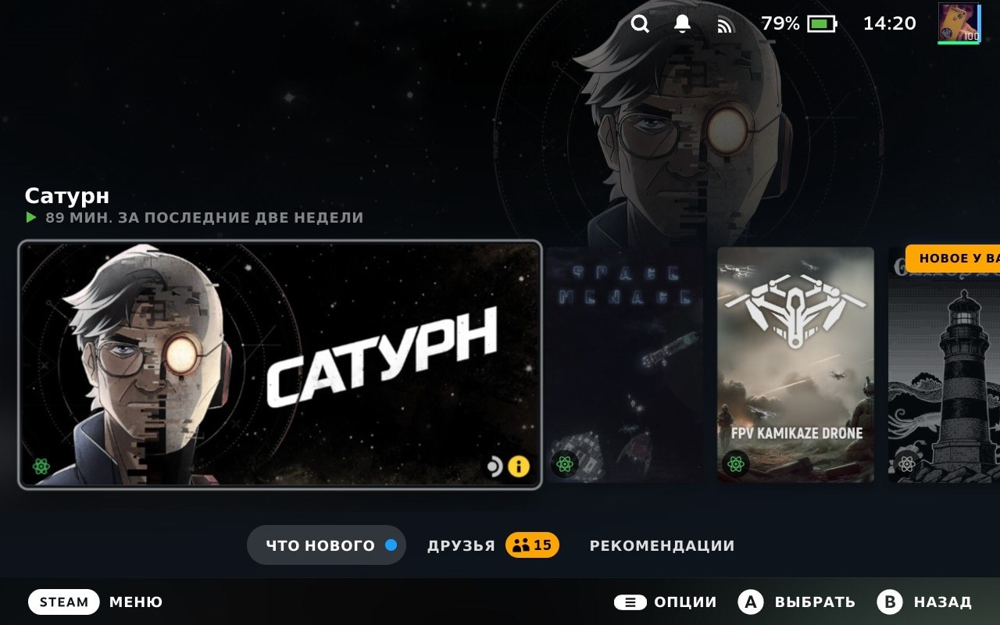
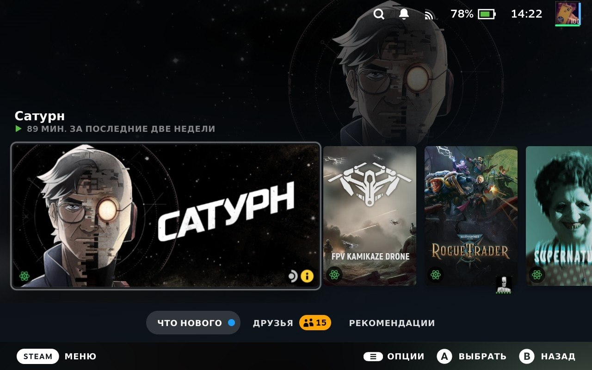

# Clearly Recent

Hide uninstalled games from your Steam Deck Home screen with this small Decky Loader plugin.

[](https://github.com/D1zg/clearly-recent/releases/latest)
[](https://github.com/D1zg/clearly-recent/releases)
[](https://github.com/D1zg/clearly-recent#top)
[](#support)

**[Download v1.0.0 ZIP](https://github.com/D1zg/clearly-recent/releases/download/v1.0.0/clearly-recent-1.0.0.zip)** · [Installation](#installation) · [Support](#support)

Requires Decky Loader. Install manually from ZIP; Clearly Recent is not available in the Decky Plugin Store.

## Screenshots

The native Home Recent Games carousel before and after enabling Clearly Recent:

| Before | After |
| --- | --- |
|  |  |

**Enjoy a cleaner Steam Deck Home? Click the Stars badge above to go to the top of this page, then select **☆ Star** to give Clearly Recent a star.**

## Installation

1. Download the ZIP above and transfer it to your Steam Deck.
2. In Decky settings, enable **Developer mode** and select **Install from ZIP**.
3. Select `clearly-recent-1.0.0.zip`, then open Library and return to Home.

Upgrading from an earlier test version? Uninstall the old plugin first to avoid running two Home patches.

To uninstall, select **Decky → Plugins → Clearly Recent → Uninstall**. Open Library and return to Home to restore the native carousel.

## How it works

Clearly Recent filters games that Steam explicitly reports as **not installed locally**, while preserving the native carousel, game order and navigation.

- Installed games and Non-Steam shortcuts remain visible.
- Unknown or transitional install states remain visible.
- Remote Play games are hidden only when Steam reliably reports they are not installed locally.
- Your Steam library, play history and database records are unchanged.

## Compatibility

The maintainer confirmed core v1.0.0 behaviour on **SteamOS 3.8.16 Stable**: Home loading, visibility during and after installation, hiding after game removal, full restart and native restoration after plugin uninstall. Successful Beta testing was also reported in the Store submission.

There is no independent third-party test report. Exact hidden-counter accuracy, the literal Active-status indicator, Remote Play, all-hidden Home and controller-focus edge cases have no separate device-test confirmation.

The plugin relies on internal Steam UI hooks, so Steam updates may break compatibility. Filtering takes effect on a native Home rerender; uncertain install states may leave an uninstalled game visible.

**Development has concluded for this release.** Source and downloads remain available; no further updates are promised.

## Building from source

Use **Node 20** and **pnpm 9.15.9**:

```sh
pnpm install --frozen-lockfile
pnpm lint
pnpm typecheck
pnpm test
pnpm build
```

`pnpm release` requires Python 3 and produces a verified ZIP and SHA256 checksum. GitHub Actions builds artifacts; it does not publish releases automatically. See [architecture](docs/ARCHITECTURE.md) for the implementation.

## Credits and license

Built using the [Decky Plugin Template](https://github.com/SteamDeckHomebrew/decky-plugin-template), with adapted Home render hooks and installation-state patterns from [Deck Shelves / Jonathan Santos](https://github.com/santojon/Deck-Shelves). Thanks to Decky Loader and Steam Deck Homebrew.

AI tools contributed substantially during development. See [development provenance](docs/PROVENANCE.md) for the disclosure and Store-submission history.

BSD-3-Clause. See [LICENSE](LICENSE) and [third-party notices](THIRD_PARTY_NOTICES.md) for attribution, dependency terms and relinking information.

## Support

Clearly Recent is free and open source. A ⭐ or sharing the plugin is always appreciated. If you would also like to leave a small tip, the details below are entirely optional.

**USDT · TON receiving address:**

```text
UQADALs2Um3G3DQkc5C4ZjiZCqHMi-uL5cllUtgsRDMJLwD6
```

[](https://t.me/walt/start?startapp=main-utm_src__wb-utm_md__owned-utm_cp__EN)

Copy the address above, then click the button to open **Walt (formerly Telegram Wallet)** in Telegram. Send **USDT on the TON network** to the copied address; the button does not prefill the recipient or send funds.

**USDT · TON only.** Minimum deposit shown by Wallet: **0.01 USDT**, excluding sender fees. Check the asset, network and full address before confirming.


Scan the original Wallet QR code if preferred, and select USDT on TON in your wallet. Deposits from sanctioned exchanges may be frozen by the receiving Wallet.
